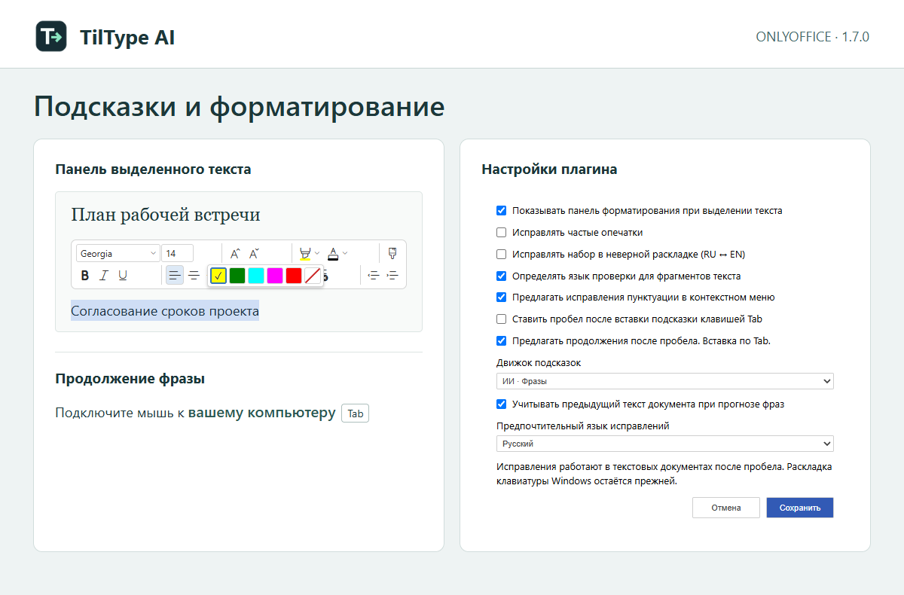

# TilType AI 1.8.0 для ONLYOFFICE

TilType AI предлагает продолжения на русском, казахском и английском во время набора. Одна компактная нейронная модель работает локально. Первая подсказка отображается бледным текстом у курсора. Нажмите **Tab**, чтобы вставить её, или выберите другой вариант из списка. При выделении текста появляется мини-панель форматирования. Её можно отключить в настройках.

[Скачать TilType AI 1.8.0](https://github.com/andqaz/tiltype/releases/download/v1.8.0/tiltype.plugin)

В настольном редакторе документов ONLYOFFICE откройте менеджер плагинов и выберите установку из файла. Укажите скачанный файл «tiltype.plugin». В манифесте указана минимальная версия редактора 10.0.0.



## Модель

В выпуск входит общий Transformer с 8 188 675 параметрами и контекстом 128 подслов. Общий токенизатор сохраняет части слов и пунктуацию. Плагин загружает веса FP16 из установочного пакета и выполняет расчёт через WebAssembly SIMD в отдельном рабочем потоке.

## Исходники и сборка

Каталог [desktop](desktop) содержит готовую структуру плагина, включая JavaScript, токенизатор, веса и ядро WebAssembly. Исходный код ядра находится в [tools/decoder.c](tools/decoder.c). Каталог [plugin](plugin) и инструменты прежней сборки сохранены для разработки предыдущего варианта.

Для сборки установочного файла из опубликованных исходников выполните:

```shell
python tools/package_desktop.py
```

Пакет будет записан в `dist/tiltype.plugin`. Для тестирования выполните `npm test`. Лицензии и сведения об источниках находятся в [desktop/licenses](desktop/licenses).
