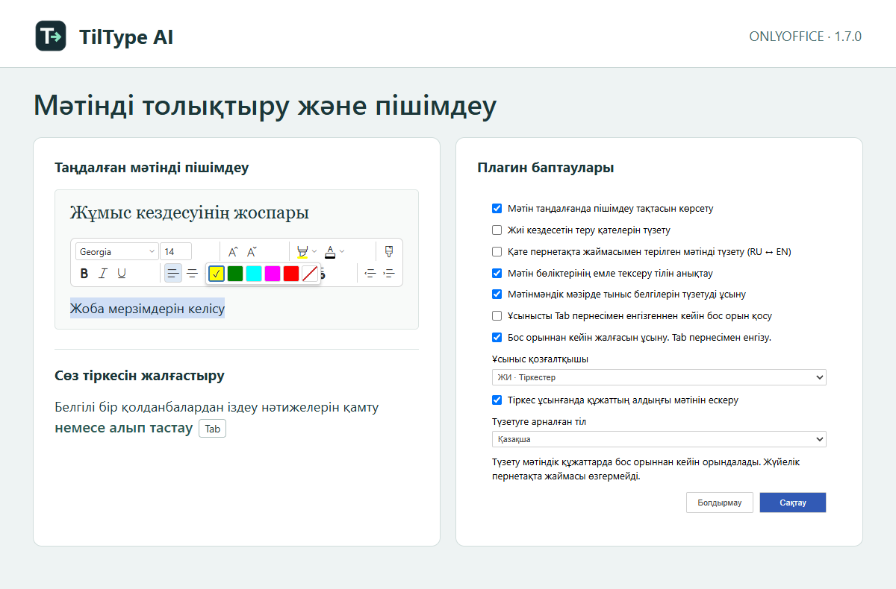

# ONLYOFFICE редакторына арналған TilType AI

[English](README.md) · [Қазақша](README.kk.md) · [Русский](README.ru.md)

Қазақша, орысша және ағылшынша сөздер мен сөз тіркестерін интернетсіз толықтырыңыз. Мәтін редакторындағы сөз тіркестері режимі алдыңғы мәтінді ескеріп, үшке дейін нұсқа ұсынады. Нұсқаны көрсеткі пернелермен таңдап, енгізу үшін **Tab** пернесін басыңыз. **Esc** тізімді жабады.

Мәтінді таңдағанда пішімдеу тақтасы ашылады. Қаріп пен оның өлшемін, мәтін мен маркер түсін өзгертуге, тізім мен туралауды реттеуге немесе пішімді басқа үзіндіге көшіруге болады. Тақтаны **TilType AI баптауларында** өшіруге болады.

**Плагиндер → Фондық плагиндер** мәзірінде **TilType AI** плагинін қосыңыз. Баптаулардан сөздікке негізделген болжамды, нейрондық желінің сөз немесе сөз тіркесі ұсыныстарын, не тәжірибелік GRU режимін таңдаңыз. Сондай-ақ теру қателері мен қате пернетақта жаймасын автоматты түрде түзетуді қоса аласыз.
