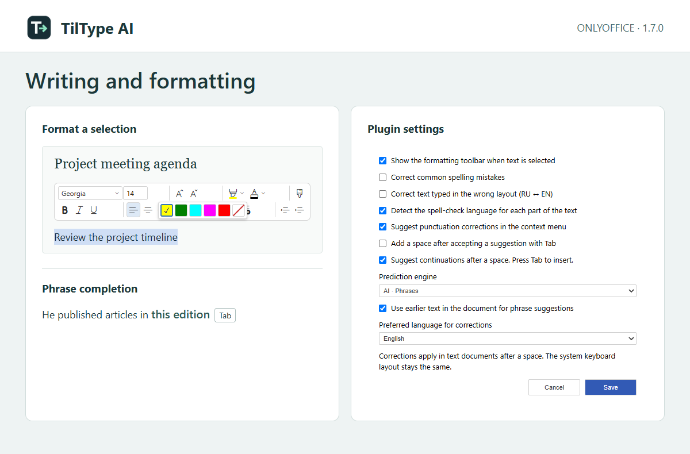

# TilType AI for ONLYOFFICE

[English](README.md) · [Қазақша](README.kk.md) · [Русский](README.ru.md)

Complete words and phrases offline in Kazakh, Russian and English. In Document Editor, phrase mode uses the preceding text and offers up to three continuations. Choose one with the arrow keys and press **Tab** to insert it. Press **Esc** to dismiss the list.

Select text to open the floating toolbar. Change the font, size, text color or highlight, apply lists and alignment, or copy formatting to another passage. Turn the toolbar on or off in **TilType AI settings**.

Enable **TilType AI** under **Plugins → Background plugins**. In settings, choose dictionary prediction, neural word or phrase prediction, or the experimental GRU mode. You can also enable typo correction and keyboard layout correction.
