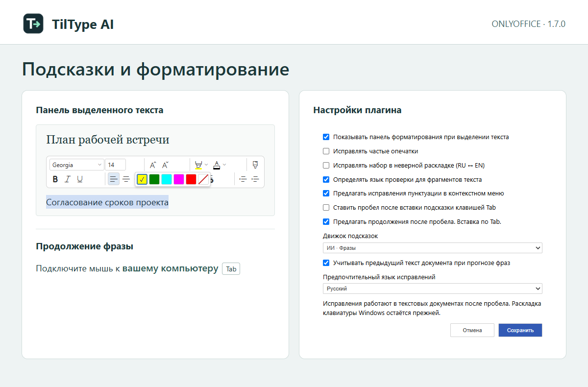

# TilType AI для ONLYOFFICE

[English](README.md) · [Қазақша](README.kk.md) · [Русский](README.ru.md)

Дополняйте слова и фразы на русском, казахском и английском без интернета. В текстовом редакторе режим фраз учитывает предыдущий текст и предлагает до трёх продолжений. Выберите вариант стрелками и нажмите **Tab** для вставки. **Esc** закрывает список.

Выделите текст, чтобы открыть всплывающую панель. Здесь можно изменить шрифт, размер, цвет текста и маркера, настроить списки и выравнивание или скопировать форматирование на другой фрагмент. Панель можно отключить в **настройках TilType AI**.

Включите **TilType AI** в меню **Плагины → Фоновые плагины**. В настройках выберите словарный прогноз, нейросетевые подсказки слов или фраз либо экспериментальный режим GRU. Там же можно включить исправление опечаток и раскладки.
